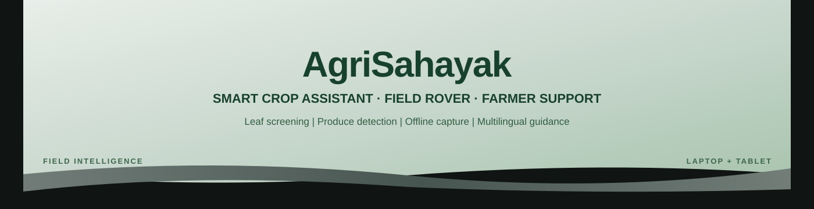
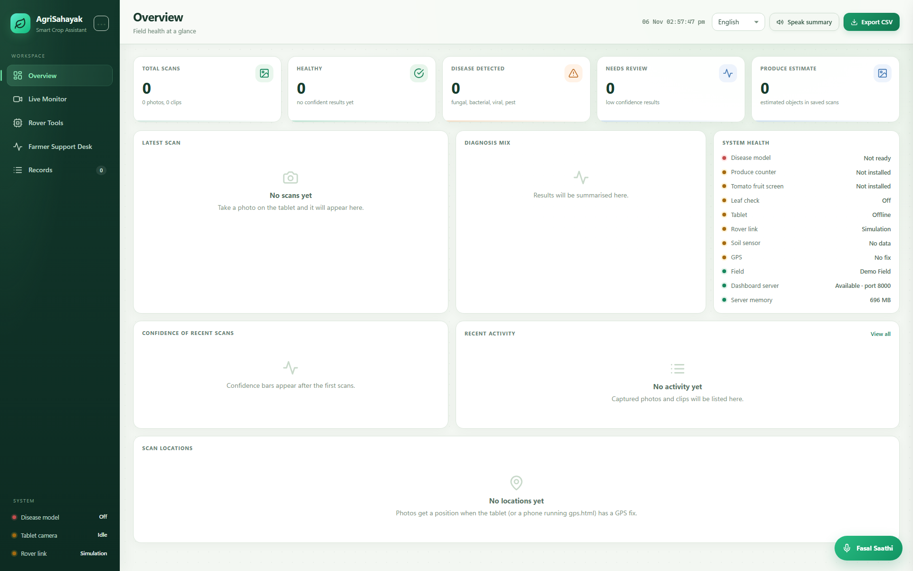
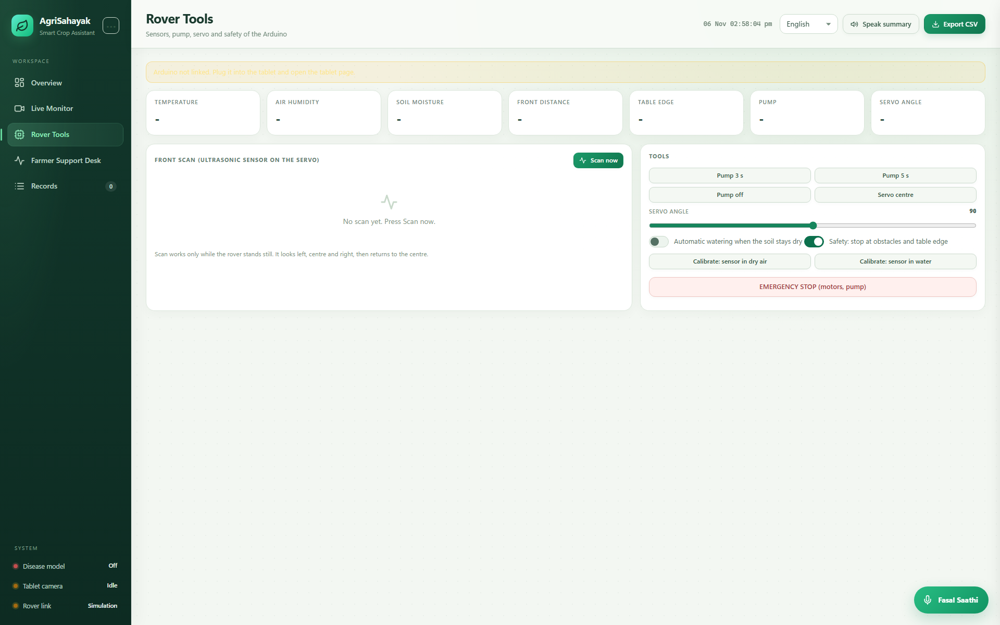
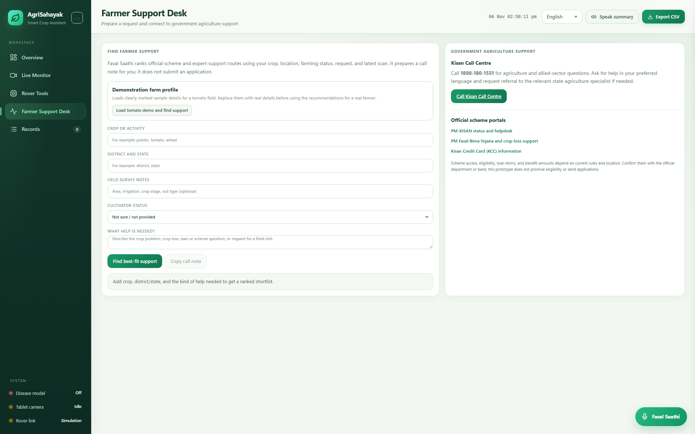
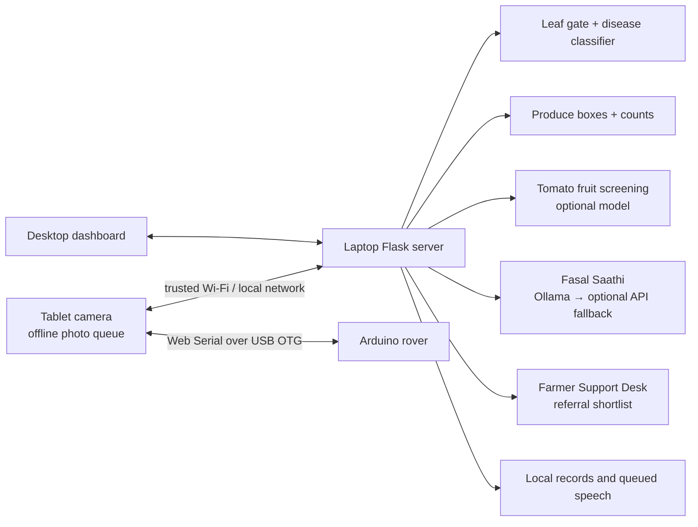

<div align="center">
  
</div>

<div align="center">

**A laptop-and-tablet agricultural rover prototype**  
Leaf screening · produce detection · offline photo capture · multilingual farm support


</div>

AgriSahayak connects a browser dashboard, a tablet camera, local vision models, optional language models, and Arduino rover firmware. The laptop performs the model inference and hosts the dashboard. The tablet can capture and queue photos while disconnected, then sync them when it reconnects.

> **Prototype limits:** model outputs are screening estimates, not diagnoses. The tablet can save photos offline, but this package does not run the vision models on the tablet. Produce counts and boxes can be wrong; tomato fruit screening does not identify a named disease. Farmer Support Desk provides referral suggestions, not eligibility decisions or applications.

## Models, classes, and inference

The laptop runs image analysis with **PyTorch and Hugging Face Transformers**, using **CUDA when available and CPU otherwise**. The tablet is a browser camera client: it can queue photos offline, but the vision models run on the laptop after sync. This repository does **not** implement ONNX or Raspberry Pi inference.

| Model | Role | Outputs | Runtime / availability |
|---|---|---|---|
| **MobileNetV2** — `linkanjarad/mobilenet_v2_1.0_224-plant-disease-identification` | Leaf health/disease classifier | **38** crop-and-condition labels (see crop table) | PyTorch + Transformers; download weights with `python download_models.py` |
| **AgriSahayak Leaf/Scene Gate**, powered by official OpenAI **CLIP ViT-B/32** — `openai/clip-vit-base-patch32` | Project-specific prompt and threshold logic compares leaf and non-leaf scene descriptions before leaf classification; it is not a disease classifier | Text-image similarity scores; no fixed disease classes | PyTorch + Transformers; the OpenAI checkpoint is downloaded by `python download_models.py` |
| **RT-DETR v1, Objects365** — `MohamedKhayat/fruit-detector-rtdetrv1-50-obj365` | Produce object detection | **12** named produce classes, boxes, and approximate counts | PyTorch + Transformers; downloaded by `python download_models.py` |
| **Optional tomato fruit screen** — fine-tuned MobileNetV2 | Extra tomato photo screening, separate from leaf disease classification | Two broad labels: healthy-looking / possible issue; uncertain below threshold | Training code is included; dataset and trained weights are not. It evaluates a combined tomato region, not each fruit or a named disease. |

The 38 leaf labels cover these crops and supported condition labels:

| Crop | Leaf-model labels |
|---|---|
| Apple | Apple scab, black rot, cedar apple rust, healthy |
| Blueberry | Healthy |
| Cherry | Powdery mildew, healthy |
| Corn (maize) | Cercospora/gray leaf spot, common rust, northern leaf blight, healthy |
| Grape | Black rot, Esca/black measles, leaf blight, healthy |
| Orange | Huanglongbing (citrus greening) |
| Peach | Bacterial spot, healthy |
| Bell pepper | Bacterial spot, healthy |
| Potato | Early blight, late blight, healthy |
| Raspberry | Healthy |
| Soybean | Healthy |
| Squash | Powdery mildew |
| Strawberry | Leaf scorch, healthy |
| Tomato | Bacterial spot, early blight, late blight, leaf mold, septoria leaf spot, spider mites, target spot, yellow leaf curl virus, mosaic virus, healthy |

The separate produce detector supports these **12 classes**. Every supported item gets a detection box and an approximate count; tomato also gets a rough surface-color cue.

| Produce class | Analysis shown |
|---|---|
| Apple | Detection box and approximate count |
| Cherry | Detection box and approximate count |
| Fig | Detection box and approximate count |
| Olive | Detection box and approximate count |
| Pomegranate | Detection box and approximate count |
| Orange | Detection box and approximate count |
| Rockmelon | Detection box and approximate count |
| Strawberry | Detection box and approximate count |
| Potato | Detection box and approximate count |
| Tomato | Detection box/count plus rough surface-color stage: mostly green, turning, mostly red, or unclear; optional image-level screen if its separate weights are installed |
| Watermelon | Detection box and approximate count |
| Bell pepper | Detection box and approximate count |

**Limits:** the 38-class leaf model is not a general crop detector. RT-DETR does not classify produce disease, freshness, food safety, or ripeness. The tomato color cue is not a validated maturity test. Green chilli is not one of the detector's 12 box/count classes. Boxes and counts can be wrong when objects overlap, are small, or are outside the model's classes. Model weights are not stored in this repository. See the [model report](docs/MODEL_REPORT.md) for upstream evaluation details and the small tomato-screen test results.

### Language and speech models

Fasal Saathi uses **Qwen3 4B Instruct** through Ollama first, with optional Groq or xAI API fallback. Speech recognition can use **SraVaani 1.0**; speech output uses Windows voices, with optional **Indic Parler-TTS**. These weights are not committed. The project code and setup steps are in [LLM/API setup](docs/LLM_AND_KEYS.md) and [voice setup](docs/VOICE_SETUP.md).

---

## What it includes

### Dashboard preview

The laptop dashboard keeps its existing Python-served HTML/CSS/JavaScript architecture. These screenshots show the redesigned overview, rover controls, and Farmer Support Desk. The review-copy screenshots intentionally use an empty, privacy-clean record store; live sensor/model values appear after connecting and running the project.

| Overview | Rover tools | Farmer Support Desk |
| --- | --- | --- |
|  |  |  |

The [dashboard design review](docs/DASHBOARD_DESIGN_REVIEW.md) includes the Live Monitor, Fasal Saathi open, and Records screenshots too.

| Component | What it does | Where it runs |
|---|---|---|
| Field dashboard | Live camera view, analysis, readings, recent records, CSV export and rover controls | Laptop browser |
| Tablet camera | Camera preview, manual/automatic capture, local queue, reconnect sync, full-screen view and language controls | Tablet browser |
| MobileNetV2 leaf classifier | Predicts one of its 38 supported leaf condition labels | Laptop CPU or NVIDIA GPU |
| AgriSahayak Leaf/Scene Gate (OpenAI CLIP ViT-B/32) | Project-specific zero-shot prompt gate before leaf classification | Laptop CPU or NVIDIA GPU |
| RT-DETR produce detector | Detects and draws boxes/counts for 12 supported produce classes | Laptop CPU or NVIDIA GPU |
| Tomato fruit screen | Optional binary “healthy-looking / possible issue” screen for a tomato image region | Laptop CPU or NVIDIA GPU |
| Fasal Saathi | Concise farm Q&A using local Ollama first, optional Groq/xAI fallback, and fixed safe responses | Laptop |
| Voice | Speech recognition and Windows speech; optional Indic Parler-TTS service | Laptop |
| Farmer Support Desk | Ranks a small set of official scheme/expert referral routes from farmer-provided details | Laptop |
| Rover firmware | Arduino serial protocol for the prototype rover and sensors | Arduino board |

## System map



## Quick start (Windows)

### 1. Prerequisites

- Windows 10/11 and Python 3.11 (64-bit).
- Git, if cloning this repository.
- Internet for initial package/model downloads. The laptop can run the downloaded vision models offline afterward.
- NVIDIA GPU is optional. CPU inference is supported but slower.

### 2. Create an isolated environment

Open PowerShell in the repository folder:

```powershell
py -3.11 -m venv .venv
.\.venv\Scripts\Activate.ps1
python -m pip install --upgrade pip
```

Install PyTorch using the command currently recommended by the [official PyTorch selector](https://pytorch.org/get-started/locally/). Select **Windows**, **Pip**, **Python**, and the CUDA option supported by your NVIDIA driver; choose **CPU** if you do not have an NVIDIA GPU. Then install the app packages:

```powershell
python -m pip install -r requirements.txt
```

The virtual environment keeps these Python packages separate from other projects. Do not run a project installer against your system Python.

### 3. Download the vision model files

```powershell
python download_models.py
```

This downloads the leaf classifier, CLIP leaf gate, and produce detector into ignored local model folders. The weights are not included in GitHub. Their licenses and source pages are listed in [Model report](docs/MODEL_REPORT.md).

The optional tomato-fruit screen is also excluded from the public package. To recreate it, follow [Tomato fruit model notes](model/tomato_fruit_disease/README.md) and obtain the cited dataset with its attribution. The dashboard should be treated as having no fruit-health result until that local model is installed.

### 4. Start the dashboard

```powershell
python server.py
```

Open [http://127.0.0.1:8000](http://127.0.0.1:8000). Keep the PowerShell window open while using the dashboard. To use the supplied launcher instead, run `start.bat` after setting up `.venv`.

### 5. Optional offline language model

Install Ollama from its [official download page](https://ollama.com/download), then pull the configured model once:

```powershell
ollama pull qwen3:4b-instruct
ollama list
```

The app tries the local model first. If it is unavailable or times out, the app uses a configured online provider if one is supplied; otherwise it uses its fixed safe responses. See [LLM and API-key setup](docs/LLM_AND_KEYS.md). Never commit a real key.

## Tablet setup

Follow [Tablet setup](docs/TABLET_SETUP.md) for camera permissions, laptop/tablet network setup, manual and automatic capture, offline queueing, USB OTG serial, and reconnection sync.

For Windows Hindi/English speech and optional SraVaani recognition, see [Voice setup](docs/VOICE_SETUP.md).

## Arduino and rover

The repository includes two firmware sketches under `arduino/`. Configure the serial port and baud rate in `config.py` only after confirming the board and wiring. The default protocol is 9600 baud. See [LM2596 and rover wiring notes](docs/ROVER_WIRING_LM2596.md). **Disconnect battery power before changing wiring.** The code repository cannot validate physical wiring or make an unverified battery pack safe.

## Farmer Support Desk

The support desk ranks a short local list of public referral routes (for example, PMFBY, KCC, PM-KISAN, Soil Health Card, MIDH and Kisan Call Centre/KVK). It asks the farmer to confirm current rules, documents, deadlines, and local availability with the official agency. It does not query a live government eligibility database, guarantee benefits, or submit applications.

## Test and model reports

- [Project test report](docs/TEST_REPORT.md) records checks run against this package and separates them from hardware tests that require a real rover/tablet.
- [Model report](docs/MODEL_REPORT.md) attributes third-party benchmark numbers to their original model cards and reports the local tomato-screen metadata with its limitations.
- Run the repository's deterministic tests with `python -m unittest discover -s tests -v`.

## Public-release and privacy policy

This repository is prepared as source code and documentation only. It intentionally excludes model weight files, `.env` files, API keys, records, voice logs, field photos, training data, generated outputs, caches, Python environments, temporary files, and editor backups. `config.py` contains blank API-key values and binds to `127.0.0.1` by default. Review `git status` and scan the package before creating a public GitHub repository.

No project-wide open-source license is included yet. The third-party model and dataset licenses remain separate; see [Model report](docs/MODEL_REPORT.md).

## Repository layout

```text
AgriSahayak-GitHub-Ready/
├── arduino/                Arduino firmware sketches
├── docs/                   Setup, model, test, and wiring notes
├── model/                  Local-only model folders (weights ignored)
├── gate_model/             Local-only CLIP files (weights ignored)
├── static/                 Dashboard and tablet web UI
├── tests/                  Deterministic source-level checks
├── voice/                  ASR, TTS, language packs, and Fasal Saathi
├── config.py               Safe defaults; keys blank
├── download_models.py      Fetches model files locally
└── server.py               Flask application entry point
```


